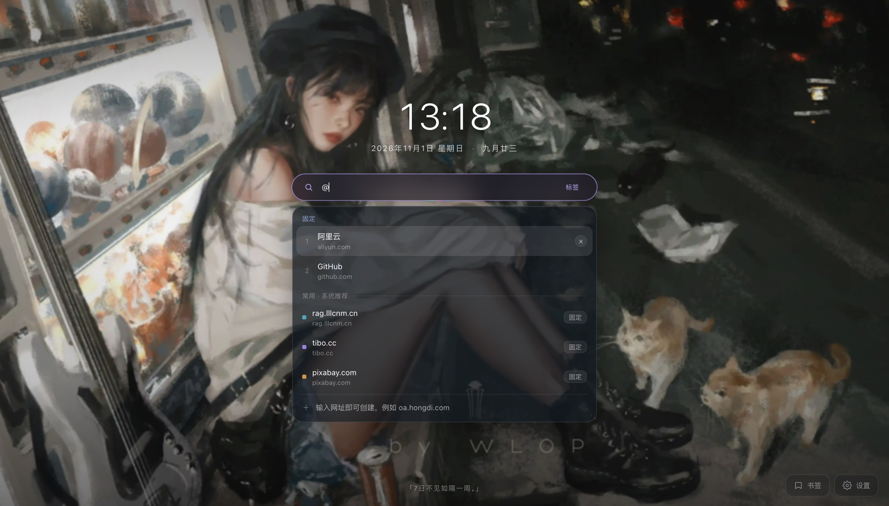
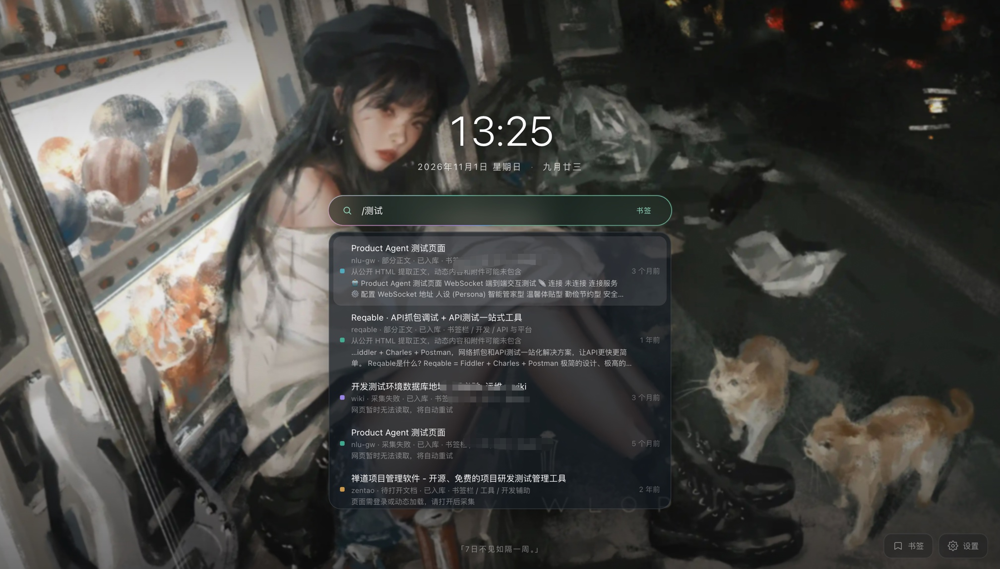
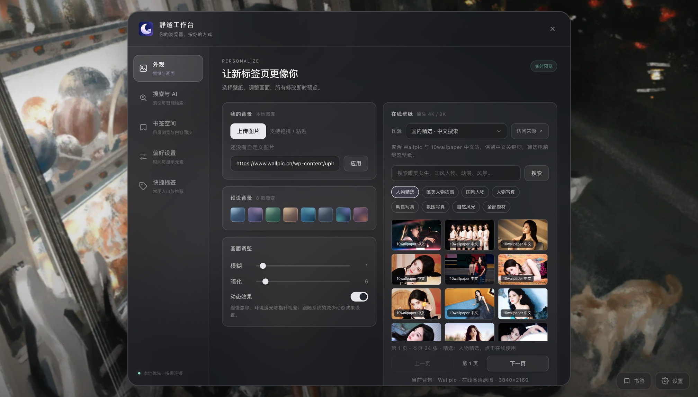
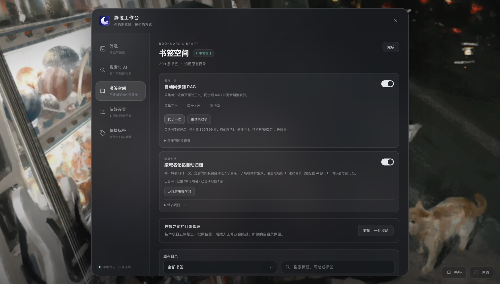
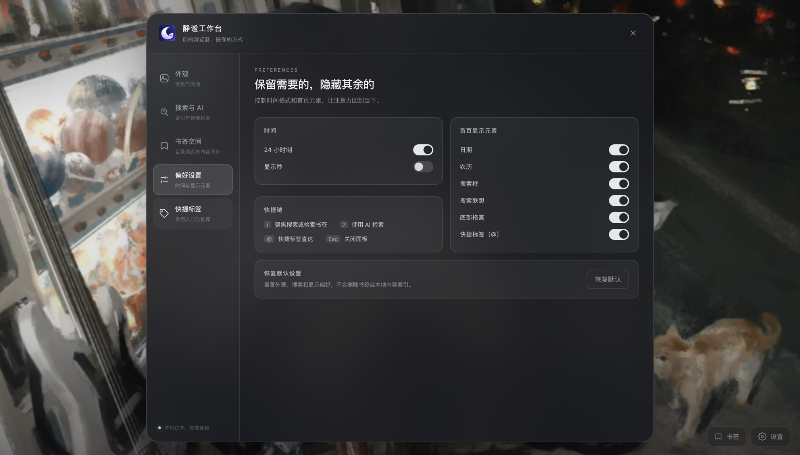
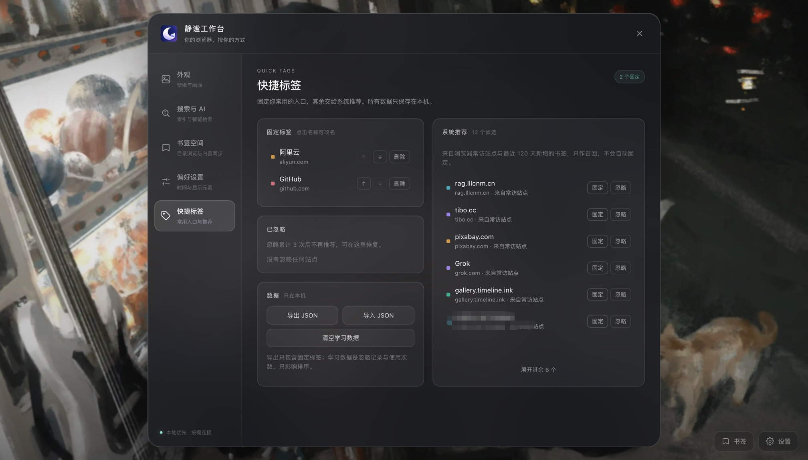

<p align="center">
  
</p>

<h1 align="center">静谧 · 新标签页</h1>

<p align="center"><strong>一打开就是安静的：大时钟、农历、一句格言，和伸手就到的书签。</strong></p>

<p align="center">
  简体中文
</p>

<p align="center">
  
  
  
  
  
</p>

<p align="center">
  <a href="#overview">项目概览</a> · <a href="#preview">界面图墙</a> · <a href="#search">搜索与检索</a> · <a href="#wallpaper">壁纸</a> · <a href="#bookmarks">书签空间</a><br>
  <a href="#ai">AI 检索</a> · <a href="#install">安装</a> · <a href="#privacy">隐私</a> · <a href="#structure">项目结构</a> · <a href="#development">开发验证</a> · <a href="#faq">常见问题</a> · <a href="#docs">文档导航</a>
</p>

<a id="overview"></a>

## 项目概览

静谧是一个 Chrome 新标签页扩展：打开新标签页只有时间、农历、搜索框、一句格言和一键可达的书签，没有推荐流，也没有需要打理的仪表盘。

它同时是一套本机优先的书签工具。搜索框用四个前缀区分意图——普通输入走网页搜索、`/` 找本机书签、`?` 让 AI 在书签正文里找答案、`@` 直达常用站点；书签仍在浏览器原有目录里，扩展只做浏览、检索与正文索引，不会替你搬家。

- **不联网也能用**：时钟、农历、格言、`/` 检索、`@` 快捷标签、预设渐变全部本地执行，断网照常。
- **联网是可选项**：在线壁纸、全网联想、`?` AI 检索各自独立开关；配置项留空就退回本地能力，不会卡在错误提示上。
- **书签目录不动**：目录浏览、按域名记忆自动归档、旧版整理可撤销，都在浏览器原有书签树上进行。
- **正文进索引，行为留在本机**：书签正文可同步到自建的 RAG 服务用于 `?` 检索，密钥与设置只存在本机。

| 领域 | 当前能力 |
| --- | --- |
| 新标签页 | 大时钟、24 小时制 / 显示秒、公历与农历、底部格言多源轮换、胶囊搜索框 |
| 壁纸 | 8 套预设渐变、上传 / 拖拽 / `⌘V` 粘贴、图片链接、9 个在线图源聚合搜索、离线图库、最近 12 条使用历史 |
| 搜索与联想 | 必应 / 百度 / Google / 搜狗全网联想、130ms 防抖、竞态丢弃、失败退必应并标注 |
| 书签检索 | `/` 本地标题、网址、目录与已采集正文检索；地址型查询（IP、主机、完整网址）直接精确匹配 |
| 快捷标签 | `@` 直达固定站点，候选来自常访与近 120 天新增书签，只召回、不自动转正 |
| 书签空间 | 原有目录浏览、域名记忆自动归档、旧版整理撤销、正文采集与入库状态 |
| AI 检索 | `?` 混合召回 + 模型重排，问答卡片只引用真实候选；无配置时冷静降级 |
| 工作台 | 外观、搜索与 AI、书签空间、偏好设置、快捷标签五个分页，居中弹层式设置面板 |
| 数据 | IndexedDB 本机存储，持久化同步队列、租约与重试，JSON 导入导出 |

**当前版本：1.14.0**（`manifest.json`）

<a id="preview"></a>

## 界面图墙

截图均为真实渲染，点击任意图片查看原图。图墙只放真实界面截图，不使用拼图或示意图。

### 新标签页 · `@` 快捷标签

<a href="docs/assets/screenshots/newtab-quick-tags.jpg"></a>

<p align="center"><strong>输入框首字符 <code>@</code> 展开标签面板</strong><br>固定区按手写顺序排列、可一键移除；「常用 · 系统推荐」来自常访站点与近期书签，点「固定」才转正</p>

### 新标签页 · 本地书签检索

<a href="docs/assets/screenshots/newtab-bookmark-search.jpg"></a>

<p align="center"><strong>输入 <code>/关键词</code> 检索本机书签</strong><br>标题、网址、目录与已采集正文一并匹配，完全不联网；登录或动态页面读不到时标注「网页暂时无法读取，将自动重试」</p>

### 工作台 · 四个核心页面

<table>
  <tr>
    <td width="50%" valign="top" align="center">
      <a href="docs/assets/screenshots/workspace-appearance.jpg"></a>
      <p><strong>外观 · 壁纸与界面</strong><br>上传、链接、8 套渐变；模糊与压暗滑杆；在线 4K 图库按题材筛选</p>
    </td>
    <td width="50%" valign="top" align="center">
      <a href="docs/assets/screenshots/workspace-bookmarks.jpg"></a>
      <p><strong>书签空间 · 目录与同步</strong><br>正文采集入库进度、域名记忆归档、撤销上一批移动、原有目录检索</p>
    </td>
  </tr>
  <tr>
    <td width="50%" valign="top" align="center">
      <a href="docs/assets/screenshots/workspace-preferences.jpg"></a>
      <p><strong>偏好设置 · 时间与元素</strong><br>24 小时制、显示秒、首页各元素开关，以及四个前缀快捷键对照</p>
    </td>
    <td width="50%" valign="top" align="center">
      <a href="docs/assets/screenshots/workspace-quick-tags.jpg"></a>
      <p><strong>快捷标签 · 固定与推荐</strong><br>改名与调序、忽略恢复、学习数据导入导出，全部只存本机</p>
    </td>
  </tr>
</table>

<a id="search"></a>

## 搜索与检索

搜索框用首字符区分四种意图，互不冲突：

| 输入 | 作用 | 是否联网 |
| --- | --- | --- |
| 普通内容 | 当前搜索引擎搜索，边打边要联想 | 是，只发送当前输入 |
| `/关键词` | 检索本机书签的标题、网址、目录与已采集正文 | 否 |
| `?描述` | 本地 + RAG 混合召回，由模型筛选并做问答 | 是，需配置 AI 接口 |
| `@标签` | 直达固定站点，输入后按名称、缩写、域名过滤 | 否 |

### 快捷键

| 输入 / 按键 | 作用 |
| --- | --- |
| 普通内容 | 实时联想当前引擎的建议词；`↑` `↓` 选择候选 |
| 普通内容 + `Enter` | 未选中候选时用当前引擎搜索；选中时打开该候选 |
| `/关键词` | 检索本地书签；回车打开选中项，方向键切换 |
| `?检索意图` | 使用 AI 检索书签正文 |
| `@` | 展开快捷标签面板；继续输入按名称、词首缩写、域名过滤 |
| `/`（未输入时） | 聚焦搜索框 |
| `Esc` | 关闭检索面板 / 设置面板，或清空搜索 |

### 全网联想

普通输入从第一个字符起就向当前搜索引擎要建议词；`/` 仍然是纯本地书签检索，两者职责不同，互不替代。

| 输入 | 候选来源 | 是否联网 |
| --- | --- | --- |
| 普通内容 | 当前搜索引擎的联想接口（必应 / 百度 / Google / 搜狗） | 是，只发送当前输入 |
| 空输入聚焦 | 本机最近搜索（最多 60 条，URL 不入库） | 否 |
| `/关键词` | 本地书签的标题、网址、目录与已采集正文 | 否 |

- 防抖 130ms：连续输入只在停顿后请求一次；慢响应回来时输入已经变化，结果直接丢弃，不会闪回上一个词。
- 命中词高亮：先把文本切成段落，再逐段转义后包 `<mark>`，`<`、`&` 之类字符不会破坏结构。
- 键盘：默认不选中任何候选，`Enter` 搜当前输入；`↑` `↓` 选中建议词后 `Enter` 搜索该词；`Esc` 收起面板后再按 `↓` 可以把它叫回来。
- 状态齐全：加载中显示骨架行；没有建议词显示「没有找到…」；接口失败显示「联想暂时不可用」，回车仍可直接搜索。
- 当前引擎不可用（离线、接口变更、Google 不可达）时自动退到必应，并标注「必应联想 · Google 联想不可用」，不会假装没有建议词。
- 隐私：普通输入会发送给对应搜索引擎的联想接口，与直接搜索的可见范围一致；请求带 `credentials: omit`，不带 Cookie。不希望外发时可在「偏好设置 → 首页显示元素 → 搜索联想」关闭，或改用 `/` 本地检索。
- 联想接口单独申请了最小范围的 host 权限（各站 suggest 路径），不额外读取页面；接口结构变化时解析失败按「无建议词」处理，不影响回车搜索。

### `@` 快捷标签

`@` 是「我已经知道要去哪」的直达通道，与 `/`（找一找）、`?`（描述要找什么）构成三种前缀模式，可同时使用、互不冲突。只在首字符为 `@` 时触发，因为 `@` 在多数站点里是账号前缀，任意位置触发会打断正常搜索。

面板分三区：

- **固定**：用户确认过的标签，按手写顺序排列，最多 8 条。新建后排在末尾，默认不被算法改动。
- **常用 · 系统推荐**：自动候选，空查询显示 3 条，输入关键词后放宽到 6 条。每条带「固定」按钮，点一次即转正。
- **新建**：`@oa.hongdi.com` 后直接回车，地址自动补 `http://` 并建成标签后打开。

候选由浏览器常访站点（`topSites`）与最近 120 天新增的书签即时生成，只做召回；进入固定区必须经过人工确认——既不要求手工维护一整套标签，也不让「每天必打卡的 OA」这类高频任务页自动霸占位置。自动候选不落库，每次打开按当前信号重算。

- 过滤支持名称、词首缩写与域名片段：`@打卡`、`@gh`（GitHub）、`@ys`（YS 应收）、`@hongdi` 都能命中；内网地址保留端口，`8.145.50.4:8000` 与 `:9000` 视为两个站点。
- 快捷键：`↑↓` / `Tab` 切换，`Enter` 打开，`Shift+Backspace` 删除或隐藏当前项，`Esc` 退出。
- 隐藏候选累计 3 次后不再推荐；删除固定标签立即生效，序号自动接续。
- 搜索引擎域名、`chrome://` 页面、带 `utm_` 或 `login?goto=` 的中转地址不进候选；同一域名只出一条，且让位给已固定的标签。
- 中文输入法组合期间不重算候选，避免列表在拼音中间态来回跳。
- 全部数据保存在本机，不联网、不申请 `history` 权限。关闭「偏好设置 → 快捷标签（@）」后，`@` 退回普通搜索字符。

工作台「快捷标签」页负责管理：固定区可点击名称改名、上移 / 下移调序、删除（8 秒内可撤销）；「系统推荐」可一键固定或忽略；「已忽略」列出被隐藏的站点并支持恢复；「数据」支持导出 / 导入 JSON 与清空学习记录。导出的 JSON 只含固定标签，忽略记录与使用次数属于本地行为数据，不随文件流转。

设计取舍与后续规划见 [`docs/quick-tags-design.md`](docs/quick-tags-design.md)。

<a id="wallpaper"></a>

## 壁纸

### 背景来源

| 方式 | 说明 |
| --- | --- |
| 在线壁纸 | 支持 Wallpic、10wallpaper 中文站、UHD Paper、Wallpaper Cave、Bing、哲风、Pexels、Unsplash、Pixabay；搜索后在线应用，按需保存离线 |
| 上传图片 | 支持上传、拖拽、`⌘V` 粘贴 |
| 图片链接 | 粘贴任意图片地址 |
| 预设渐变 | 8 套深色渐变 |

### 在线 4K 图源

默认使用「全部高清图源 · 国内优先」聚合搜索，空搜索框推荐人物插画与国内写真。可切换「国内精选」聚合 [Wallpic](https://www.wallpic.cn/) 与 [10wallpaper 中文站](https://www.10wallpaper.com/cn/)，或单独选择其他来源。

| 图源 | 搜索范围 | 清晰度与使用方式 |
| --- | --- | --- |
| Wallpic | 中文关键词搜索，电脑静态壁纸 | 国风、动漫、人物题材；公开图像须实测达到 4K |
| 10wallpaper 中文站 | 中文关键词搜索 | 读取公开 4K / 5K 下载地址，应用前实测像素 |
| Pexels（可选） | 官方摄影图库搜索，需自己的 API Key | 原始照片、作者署名、实际像素检查 |
| Unsplash（可选） | 官方摄影图库搜索，需自己的 Access Key | 原始照片、作者署名与使用追踪 |
| Pixabay（可选） | 官方 JSON 接口搜索，需自己的 API Key | 人像、时装、风景与描述式检索；普通 Key 实测最大 1280 宽 |
| UHD Paper | 全站关键词搜索，支持常见中文词转换 | 优先 8K / 4K 公开图片，实测像素后在线应用 |
| Wallpaper Cave | 搜索相关主题，从匹配图集中筛选 | 筛选标注 4K 的图片，应用前再次检查真实像素 |
| Bing | 最近八天精选，按中文标题、地点或日期筛选 | 使用 UHD 图片地址，应用前检查真实像素 |
| 哲风 | 站内关键词搜索 | 原图接口需要登录授权，无授权时明确显示公开预览 |

### 行为约定

- 点击壁纸默认**在线应用**，只保存图片地址、来源及分辨率，不自动把文件写入离线图库。浏览器仍需加载图片数据，后续按自身 HTTP 缓存策略复用；不是每次主动下载一份文件。
- 点击「保存到离线图库」时才下载并保存原始 Blob，无二次压缩。再次保存会复用已有合格缓存；点击图库缩略图可改为离线背景。
- 高清图源均须解码确认至少为 3840×2160，低清响应、HTML 重定向或图片加载失败不会覆盖当前背景。8K 不可用时可尝试同一页面提供的 4K；不以缩略图充当高清背景。
- 中文图库直接检索中文，不翻译成英文；海外图源按词意扩展。「美女」扩展为 woman、model、portrait；「动漫美女」保持 anime girl 意图，国风人物保留插画和真人题材。聚合结果跨图源去重，每页 24 张，单个图源故障保留其他结果；有足够匹配结果时，国内图源获得更多展示位置。
- 「人物精选」同时覆盖精细女性插画、国内明星与女性写真；「唯美人物插画」单独筛选幻想、国风、动漫等人物题材，不绑定特定作者。另提供国风人物、人物写真、明星写真、氛围写真、自然风光和全部题材入口。偏好保存在本机，主动输入关键词可搜索其他题材。
- 题材筛选使用图源搜索词、标题和标签线索，排除明显无关的风景、普通卡通以及手机、动态、头像条目；这不等于视觉模型对每张图片的审美评分，仍可能混入少量不合偏好的结果。4K 则始终依据实际解码尺寸校验。
- Wallpaper Cave 会按需继续读取后续图集，不再截断在前三个图集。国内图库按原站真实链接分页，避免搜索翻页回到首页。
- UHD Paper 和 Wallpaper Cave 支持英文搜索，动漫、风景、自然、星空、极简、赛博等常用中文词会转换为对应英文。各图源使用独立页码与缓存；翻页按站点游标或当前主题结果分页。
- 专业摄影图库为可选接入：选择 Pexels 或 Unsplash 后填写自己的 Key（[Pexels 官方 API](https://www.pexels.com/api/)、[Unsplash 开发者入口](https://unsplash.com/developers)）。Key 仅保存在本机，只发送到对应 API；图片 CDN 请求不附带 Key。配置后参与聚合；未配置时不请求这两个接口。摄影师署名链接显示在缩略图下。无真实账号 Key 时，自动测试使用接口替身验证，不能据此声称已完成真实账号联调。
- 哲风原图与公开预览是两个通道。读取登录状态需按需申请 Cookie 权限，Token 仅用于哲风接口，不发送给其他图源。服务器授权、额度和验证码条件仍由站点控制。
- Pixabay 只接官方接口，不抓页面：整站（含 `/images/search/`）由 Cloudflare 托管挑战保护，实测返回 403 挑战页、正文只有 Turnstile 脚本，没有任何图片数据；`pixabay.com/api/` 则对扩展开放（`access-control-allow-origin: *`）。Key 仅保存在本机，只发送到 pixabay.com。该接口始终带 `safesearch=true`，不提供关闭入口。
- Pixabay 的清晰度如实标注：普通 Key 的响应里没有 `imageURL` / `fullHDURL`，`largeImageURL` 实测解码为 1280×853，CDN 的 `_1920` / `_2560` / `_3840` 后缀一律 403。因此以 1280×720 为可用下限、标「高清」而不标 4K；只有真的解码到 3840×2160 才记作原图。
- 描述式检索：把一整句描述拆成主体 / 场景 / 光线 / 风格 / 色调五类概念词，组合出最多 3 条检索式——国内图库用中文组合，海外图源用英文组合。结果按命中概念加权排序，同分保留图源原有配额，不会让某个图源被挤没。全部在本地词表完成，不联网也不依赖配置。
- 搜索联想：输入时取描述里最靠前的两个概念，再补一个还没写到的氛围词，给出 3–4 条可直接点的短语；配置了 AI 时会多一个「AI 联想」，由模型把口语压成 2–5 个检索短语，失败自动退回本地建议。联想只产出检索词，不生成图片描述。
- 使用历史：壁纸卡片底部保留最近 12 条在线应用记录（来源、标题、缩略图、地址、尺寸、时间），点缩略图直接恢复——复用已解析的地址，不再请求图源；可一键清空。历史只存本机。
- 来源、原始图片和真实分辨率会记录在设置或离线图库中。默认更换图源不会删除已有背景或旧图库；线上地址失效时可重新选图，或使用此前主动保存的离线版本。
- 拾光壁纸（gallery.timeline.ink）用于风格参考，未伪装为已接入图源：当前公开页面的聚合接口直接请求返回「授权 KEY 缺失」，需要按其开放接口授权方式单独对接。
- 版权归原站与原作者，请仅作个人桌面使用。

<a id="bookmarks"></a>

## 书签空间与正文索引

工作台「书签空间」沿用浏览器原有目录，可以按文件夹浏览、搜索书签并查看正文采集和入库状态。旧版自动分类设置不再生效；目录整理由域名记忆接手，不会创建新目录。

### 域名记忆与自动归档

收藏时不需要先点目录：后台按「域名 → 目录」记忆归档。归属记忆有三种来源：

- **学习**：同一域名已有至少两条收藏、且多数落在同一个非默认目录时，自动形成域名规则；子域名共享该规则，也可为具体站点单独覆盖。
- **手动**：收藏时主动选择目录，或把书签拖进目录，立即记成该站点的规则。手动与已确认规则不会被后续学习覆盖。
- **AI 确认**：陌生域名只登记为「待确认」，由配置的 AI 接口给出目录建议；确认后才移动并写入站点规则，不会擅自归类。

同一域名下两个站点确认到同一目录后，会升级为整域规则，之后该域名的其他子域名直接继承；单站点仍保持主机级规则，不会误伤 `docs.`、`mail.` 这类多用途域名。

规则、待确认建议和归档开关都在「书签空间 → 按域名记忆自动归档」。自动移动写入同一份移动日志，可用「撤销上一批移动」恢复原位置；关闭开关后只学习、不移动。批量导入期间暂停自动归档，导入结束后重新学习一次。

域名规则保存在本机 IndexedDB。AI 建议只发送标题、主机名、URL 路径、当前目录和既有目录路径列表，不发送正文；需要先在搜索与 AI 设置中配置接口。AI 不可用时仅使用学习与手动规则。

### 配套服务：QuillRAG

> RAG 服务端不在本仓库内，使用独立的开源项目 [QuillRAG](https://github.com/ArtLjn/QuillRAG)（MinerU PDF 解析、混合检索与 Cross-Encoder 重排）。自行部署后，把服务地址和该服务签发的 API Key 填进扩展即可。

扩展只调用四个端点，默认集合以 `chrome_tab_` 开头：

| 端点 | 用途 |
| --- | --- |
| `POST /collections` | 创建或复用书签集合 |
| `POST /ingest` | 提交页面正文与元数据（multipart） |
| `POST /retrieve` | 混合召回（`mode: hybrid`、`rerank: true`） |
| `DELETE /collections/{name}/documents/{id}` | 删除失效文档 |

不部署 QuillRAG 时，`/` 本地检索与其余功能不受影响，仅 `?` 检索失去云端正文召回。

### 正文采集 → 同步 → 索引

展开「连接与同步设置」，填写 RAG 地址、API Key 与书签集合。开启「自动同步到 RAG」后，后台统一完成整条链路，不需要另外建立索引，也不依赖 AI 模型开启。

- 新增、修改、移动和删除收藏会进入同一持久化同步队列。原有目录路径作为收藏元数据同步，用于检索；同步不会修改浏览器目录。
- 「同步一次」只执行本次任务，不打开自动开关；「重试失败项」重新提交失败或待打开 / 授权的任务，复用成功页面。连接设置内可暂停当前同步。
- 公开页面按具体 URL 抓取正文，保存摘要、内容指纹和采集时间。同域名的不同路径、有意义的查询参数与 SPA 路由分别处理，不会因为标题或域名相同就合并。
- 正文刷新默认 7 天，可设 1–90 天。这是定时检查，而非网站主动推送。最多读取约 1 MB HTML、保存 25 万字符正文，动态内容和附件可能未包含。
- 登录或动态页面无法自动读取时显示待打开状态。先收藏并打开具体页面，再点击扩展图标采集已渲染正文。采集会遍历可识别的正文块、滚动并去重，始终记录覆盖说明。
- 登录正文默认只保存在本机；开启「上传手动采集的登录页面正文」后才上传。关闭该选项并同步会清理此前上传的相应记录。元数据入库不等于正文采集成功，每条书签分别显示采集与入库状态。
- 关闭自动同步停止后台同步，已同步内容和本地缓存仍可搜索。API Key 仅保存在本机；默认集合以 `chrome_tab_` 开头，与个人记忆集合隔离。

队列由扩展后台执行，关闭新标签页后仍可续办；浏览器完全退出或设备休眠时不执行，恢复后由 alarm 唤醒。失败使用指数退避，最多自动尝试 5 次，之后需检查配置并重试。多人分发需要服务端认证和数据隔离，不能共享个人密钥。

- **不会重复入库**：同一页面的多个收藏合并为一份文档；内容与稳定元数据（网址、标题、正文指纹、收藏入口、目录等）未变的重复同步会跳过 ingest，定时刷新不会因采集时间变化而重新入库。本地实例标识变化时会先入新记录、再删除旧 docId。
- **删除及时**：删除收藏后立即标记队列；后台在线时约 1.5 秒内重建并触发同步，后台被回收时由下一个 30 秒 alarm 接管。云端删除任务优先于新增 / 刷新任务，避免被大批量同步饿死。删除最后一个收藏入口才移除云端文档；同步状态记录丢失时会按当前 docId 规则重试删除。
- **中断可恢复**：任务、任务代次和租约保存在 IndexedDB。后台被回收时，超过 60 秒租约的 `running` 任务由下一次 alarm 或启动唤醒接管；单次采集 5 秒、单次 RAG 请求最长 20 秒，租约足够覆盖。服务不可用时按 30 秒起指数退避，最多 5 次后暂停自动连接，手动重试可恢复。
- **同步速度**：每个任务只处理当前文档，不再全量拍平书签树或 reconcile 全部文档；alarm 周期 30 秒（旧版 Chrome 自动钳制为 1 分钟），单次后台最多连续工作约 18 秒，避免影响其他扩展功能。

### 索引结构

本地 IndexedDB 保存书签元数据、页面缓存、文档及同步任务，旧版目录整理日志继续保留供主动恢复。RAG 是正文检索索引，不负责移动浏览器书签。

- 文档按规范化的具体页面地址区分，保留有意义的参数与路由。相同页面的多个收藏入口关联一份正文；旧版文档身份和别名继续兼容，不依据标题或语义相似度合并。
- RAG 每个文档拆成多个内容块，元数据包含文档身份、规范 URL、标题、收藏入口及时间、目录、分类、标签、正文指纹、采集时间、来源、覆盖范围和版本。向量由线上 RAG 服务生成。
- 删除一个收藏入口仅更新关联，删除最后一个入口才删除云端文档。旧版按书签 ID 入库的记录在后台迁移清理。

### 旧版整理的恢复

本机存在可撤销日志时，书签空间显示「恢复之前的目录整理」。点击后按日志恢复上一批父目录和顺序，并跳过后续人工修改的条目；域名记忆的自动归档与旧版整理共用这份日志。不会自动回滚、删除目录或批量迁移没有日志的书签；旧版创建的空目录保留，避免误删后续加入的内容。

<a id="ai"></a>

## AI 检索

`?` 是「描述你要找什么」的通道，检索范围覆盖本机已采集正文与 RAG 召回片段。

- 普通输入直接搜索网页，`/关键词` 检索本地标题、网址与已采集正文，`?描述` 使用本地和 RAG 混合召回并由模型筛选。
- **地址型查询直接本地精确匹配**：IP、带端口的主机、完整网址和常见域名不经过模型改写与重排，避免 IP 被语义模型改错，也省掉两轮等待。`8.145.50.4`、`8.145.50` 这类部分 IP 会按主机前缀排序，完整主机始终优先。
- 普通关键词仍交给模型筛选；本地候选足够多时跳过查询改写，只做一次重排；零召回或弱召回才调用改写下同义词。标题、网址或主机精确命中的结果在重排后强制保留，不会被模型隐藏。
- **问答式检索**：`?` 后面是问题且候选里有正文或 RAG 片段时，先用「AI 回答」卡片给结论，再列可点击的来源；来源 id 必须命中真实候选，模型只看到截取后的证据片段。证据不足就退回普通书签结果，不编造答案。关键词查询不生成答案，只返回模型挑选的来源。
- `/` 完全在本机执行；`?` 把问题及候选标题、目录、摘要和相关片段发给配置的 AI 接口。候选包含完整 host，IP 与子域名不会只剩首位数字。网页中的指令视为数据，模型只能选择实际候选 ID；接口失败保留本地结果。
- 搜索使用采集链路已保存的内容，不在搜索过程中额外触发一套采集任务。登录内容即使未上传 RAG，也可能在使用 AI 搜索时作为相关片段发送给 AI 接口。
- `?` 按文档聚合相关段落后由 AI 筛选，结果指向具体页面及收藏入口，排除未知 ID、失效链接和不匹配的正文版本。

AI 功能的现状、场景优先级、版本路线与关键设计见 [`docs/design/ai-roadmap.md`](docs/design/ai-roadmap.md)。

<a id="install"></a>

## 安装

```bash
git clone https://github.com/ArtLjn/Jingmi-Tab.git
```

1. Chrome 打开 `chrome://extensions/`
2. 右上角开启「开发者模式」
3. 点「加载已解压的扩展程序」，选择克隆下来的目录
4. 新建标签页即可看到效果

不需要构建步骤：仓库即扩展本体，JavaScript 原生实现，无打包器和框架依赖。

<a id="privacy"></a>

## 隐私与数据

- 设置、书签元数据、采集正文、离线图库与学习记录全部保存在本机（`chrome.storage` + IndexedDB），不做账号体系，不上传遥测。
- 所有外发都可追溯：普通输入只发当前引擎的联想接口，`?` 只发配置的 AI 接口，书签正文只在开启 RAG 同步后发到你自己的服务。
- 权限按需申请：`history` 与 `cookies` 是可选权限，用到对应功能时才请求；其余 host 权限限定到具体站点与联想路径。
- 更换图源、关闭开关都不会删除已有背景、图库或已同步内容。

<a id="structure"></a>

## 项目结构

```
manifest.json          扩展清单（MV3，版本 1.14.0）
newtab.html            页面结构
css/newtab.css         样式（深色玻璃弹层与工作台布局）
assets/                图标与 Logo 母版
docs/quick-tags-design.md   快捷标签功能设计
docs/design/ai-roadmap.md   AI 功能路线与设计
docs/assets/screenshots/    界面图墙原图
js/store.js            设置持久化 + 图片库(IndexedDB) + 预设渐变
js/newtab.js           时钟、农历、搜索、背景、面板逻辑
js/workspace.js        工作台分组导航
js/wallpaper.js        图源路由、哲风兼容与按需离线下载
js/wallpaper-cn.js     Wallpic 与 10wallpaper 中文检索及公开高清地址
js/wallpaper-uhd.js    UHD Paper 搜索、分页与高清地址解析
js/wallpaper-sources.js Wallpaper Cave 搜索与 Bing 精选
js/wallpaper-photos.js Pexels 与 Unsplash 官方摄影图库接口
js/wallpaper-pixabay.js Pixabay 官方接口、题材词转换与真实尺寸校验
js/wallpaper-search.js 人物意图扩展、聚合检索、去重与分页
js/wallpaper-assist.js 描述式检索、搜索联想与结果加权
js/search-suggest.js   全网联想：接口解析、防抖与状态机
js/quick-tags.js       @ 标签匹配、候选生成与写操作
js/tag-manager.js      快捷标签管理页
js/bookmarks.js        本地召回、排序与内容片段
js/bookmark-search.js  AI 检索流程编排
js/bookmark-answer.js  基于正文与 RAG 片段的问答和来源校验
js/ai.js               模型请求、改写与重排
js/db.js               书签、采集缓存、文档与任务数据库
js/documents.js        文档身份、别名关联、正文版本和状态
js/content-index.js    内容缓存合并与有效期
js/capture-adapters.js 通用公开 HTML 正文采集
js/page-capture.js     浏览器已渲染正文与虚拟滚动采集
js/sync-engine.js      后台持久化队列、alarm、重试与恢复
js/rag.js              QuillRAG 同步与召回
js/rag-settings.js     本机 RAG 配置
js/organizer.js        旧版分类元数据的兼容读取
js/organizer-moves.js  移动日志的主动恢复
js/organizer-ui.js     原有目录浏览与采集状态
js/bookmark-auto.js    域名记忆、历史学习、自动归档与 AI 建议
js/auto-organizer-ui.js 归档规则与待确认建议面板
sw.js                  后台 Service Worker
tests/                 自动化与真实 Chrome 浏览器回归
tools/gen-icons.js     生成扩展图标（无第三方依赖）
tools/check-js.js      JavaScript 语法检查
```

<a id="development"></a>

## 开发验证

```bash
npm ci        # 安装开发依赖
npm test      # 119 项自动化断言
npm run lint  # 53 个 JavaScript 文件语法检查
```

`npm test` 覆盖内容采集、IndexedDB 重载、缓存、任务恢复、IP 精确检索、问答引用、重复入库防护、原目录保持不变、域名记忆归档、搜索联想、快捷标签与 AI 降级。浏览器回归使用本机 Chrome，其他系统可设置 `CHROME_PATH`。

自动测试以本地接口替代扩展 API、RAG 和 AI 服务，不访问真实书签或使用真实凭证。浏览器用例覆盖正文同步与检索、保留原有目录、旧日志撤销、自动同步开关、归档面板、快捷标签管理页与窄屏布局。线上联调单独使用临时测试集合，结束后删除。

图标母版为 `assets/logo.png`（「月下书页」，深靛蓝、月白与淡紫），替换后运行 `node tools/gen-icons.js` 可无额外依赖重新导出 16 / 32 / 48 / 128px 图标，透明边缘按面积加权缩小。

<a id="faq"></a>

## 常见问题

**必须联网才能用吗？**
不。时钟、农历、格言、`/` 检索、`@` 快捷标签、预设渐变全部本地执行。在线壁纸、全网联想、`?` AI 检索都是可选项。

**不部署 QuillRAG 会坏掉吗？**
不会。`/` 本地检索照常工作，只是 `?` 检索失去云端正文召回，退回本地候选。

**会自动移动我的书签吗？**
只会按你确认或学习到的域名规则归档，且每次移动写入同一份日志，可「撤销上一批移动」。关闭开关后只学习、不移动。

**为什么有的在线壁纸标「高清」而不是 4K？**
清晰度按实际解码像素标注：只有真的解码到 3840×2160 才记原图。Pixabay 普通 Key 的最大宽度实测为 1280，所以标「高清」。

**和 Arc / Momentum 这类新标签页比，差别在哪？**
本地优先：没有账号、没有云同步、不采集行为数据；书签检索、正文索引与 AI 检索都跑在你自己的机器和自建服务上。

<a id="docs"></a>

## 文档导航

| 文档 | 内容 |
| --- | --- |
| [`docs/quick-tags-design.md`](docs/quick-tags-design.md) | `@` 快捷标签：需求、存储设计、接入点与验收标准 |
| [`docs/design/ai-roadmap.md`](docs/design/ai-roadmap.md) | AI 检索的现状、场景优先级与版本路线 |
| [`docs/assets/screenshots/`](docs/assets/screenshots/) | 界面图墙原图（2016px 宽，JPEG q92） |
| [QuillRAG](https://github.com/ArtLjn/QuillRAG) | 配套 RAG 服务（独立仓库） |

## 致谢与许可

- 壁纸版权归各图源与原作者，本项目仅提供检索与展示入口，请作个人桌面使用。
- 图标由内置 imagegen 生成；生成提示词概要：深靛蓝圆角底、月白与淡紫的粗轮廓月牙、融合一处翻页形状，大面积留白、透明外边缘、小尺寸清晰，不含文字、星星、时钟、细线或投影。
- 仓库暂未附加开源许可证，默认保留所有权利；需要复用请先开 issue 沟通。
